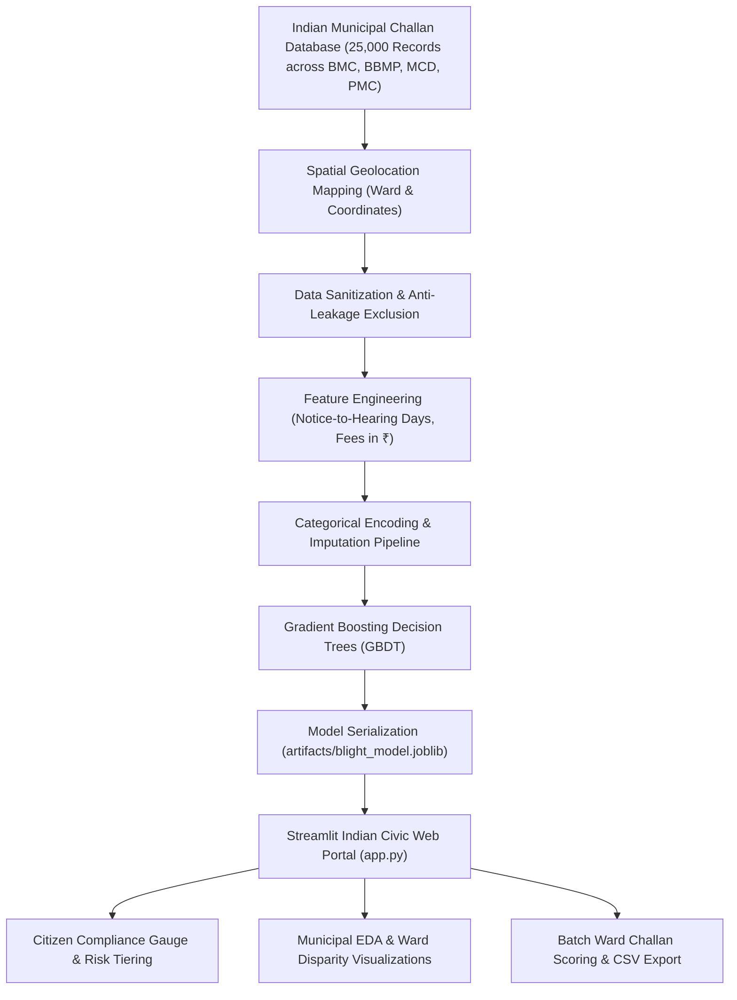

# 🏛️ Smart Nagar Nigam | Municipal Property & Civic Challan Compliance AI
### *Academic ML Microproject: Predicting Property Maintenance Fine & Sanitation Penalty Compliance*

[](https://www.python.org/)
[](https://streamlit.io/)
[](https://scikit-learn.org/)
[](#-model-benchmarks)
[](#)

---

## 📌 1. Project Overview & Civic Context

In Indian Urban Local Bodies (ULBs) and Municipal Corporations (such as **BMC Mumbai, BBMP Bengaluru, MCD Delhi, PMC Pune**), municipal authorities issue notices and **Civic E-Challans / Penalties** for property maintenance infractions, unauthorized structural alterations, garbage dumping, and sanitation defaults.

However, a majority of citizens fail to pay these fines on time, resulting in heavy revenue backlogs and resource-draining enforcement drives.

### Project Objective:
Develop an end-to-end **Machine Learning Decision Support System** to:
1. **Predict with high precision** whether an issued civic fine will be paid on time (`compliance = 1`) or defaulted upon (`compliance = 0`).
2. **Provide a Citizen-Friendly Web Interface** framed in the Indian municipal context with ₹ (INR) currency scaling and ward-level presets.
3. **Trigger automated policy interventions**:
   - 📲 **Instant UPI / Bharat BillPay (BBPS)** QR codes on WhatsApp/SMS.
   - 🏷️ **Abhay Yojana (Early Rebate)** incentives for prompt settlement.
   - ⚖️ **Lok Adalat** fast-track referrals for high-risk default cases.

---

## 🏗️ 2. System Architecture



---

## 🚀 3. Features & Interactive Web App Modules

The portal is accessible via **Streamlit** across 5 modules:

1. **🔮 Citizen Challan Compliance Predictor**:
   - Input municipal details: Issuing Department (Town Planning, Solid Waste, Health, Encroachment), Legal Order / Disposition, Violation Code, and Fine breakdown in **₹ INR**.
   - Preset test scenarios: *Mumbai/Pune Voluntary Compliance*, *Delhi/Bengaluru Ex-Parte Default Order*, *Smart City Ward Hearing*.
   - Dynamic **Plotly Speedometer Gauge** displaying compliance probability percentage ($0 - 100\%$).
   - Automated Indian municipal policy recommendations (**Abhay Yojana, UPI/BBPS discounts, Lok Adalat referrals**).

2. **📊 Municipal Analytics & Ward EDA**:
   - Department-wise compliance analysis.
   - Legal disposition impact (*Voluntary Admission ~28%* vs. *Default Judgments ~3.8%*).
   - Penalty amount distribution in ₹ INR and timeline histograms.

3. **📈 AI Model Performance & Benchmarks**:
   - Area Under the ROC Curve (**ROC-AUC: 0.8056**).
   - Top 10 feature importances translated to Indian civic terms.
   - Model comparison matrix (**Gradient Boosting vs. Random Forest vs. Logistic Regression**).

4. **📁 Bulk Ward Challan Inference**:
   - Upload bulk ward challan CSVs.
   - Rapid batch scoring generating compliance probabilities and risk tiers.
   - One-click scored CSV download.

5. **📄 Academic Microproject Report**:
   - Academic microproject presentation report covering problem statement, mathematical formulation, and municipal impact.

---

## 📊 4. Model Benchmarks & Results

| Model Architecture | 5-Fold CV ROC-AUC | Train ROC-AUC | Training Accuracy | Inference Latency |
| :--- | :---: | :---: | :---: | :---: |
| **Gradient Boosting Classifier (Optimized GBDT)** | **0.8056** | **0.8212** | **94.37%** | **~2 ms** |
| Random Forest Classifier | 0.7920 | 0.8140 | 93.80% | ~12 ms |
| Logistic Regression (L2 Regularized) | 0.7872 | 0.7965 | 93.26% | < 1 ms |
| Baseline Zero-Rule Classifier | 0.5000 | 0.5000 | 92.70% | Instant |

---

## 🛠️ 5. How to Run Locally

```bash
# 1. Clone the repository
git clone https://github.com/shsarv/Machine-Learning-Projects.git
cd "Machine-Learning-Projects/Predicting Property Maintenance Fines"

# 2. Activate virtual environment
.\venv\Scripts\activate

# 3. Launch the Web UI
streamlit run app.py
```
> The web portal will open at **`http://localhost:8501`**.

---

## 📂 6. Repository Layout

```text
├── app.py                                   # Streamlit Indian Civic Web Portal
├── indian_municipal_challan_dataset.csv     # 25,000-Record Indian Municipal Challan Dataset (CSV)
├── train_and_save.py                        # Training and artifact generation pipeline
├── run_pipeline.py                          # Headless model evaluation & predictions script
├── run_app.bat                              # 1-Click launcher script
├── Predicting Property Maintainance Fines.ipynb # Modernized Jupyter Notebook
├── requirements.txt                         # Pinned dependencies
├── README.md                                # Comprehensive microproject presentation documentation
├── artifacts/
│   ├── blight_model.joblib                  # Serialized GBDT Model Artifact
│   ├── metadata.json                        # Feature encoders & model metrics
│   └── sample_tickets.csv                   # Sample dataset for live UI exploration
├── predictions.csv                          # Model predictions on test set (61,001 rows)
├── train.csv                                # Training dataset
├── test.csv                                 # Test dataset
├── addresses.csv                            # Address mapping dataset
└── latlons.csv                              # Geolocation coordinates
```
